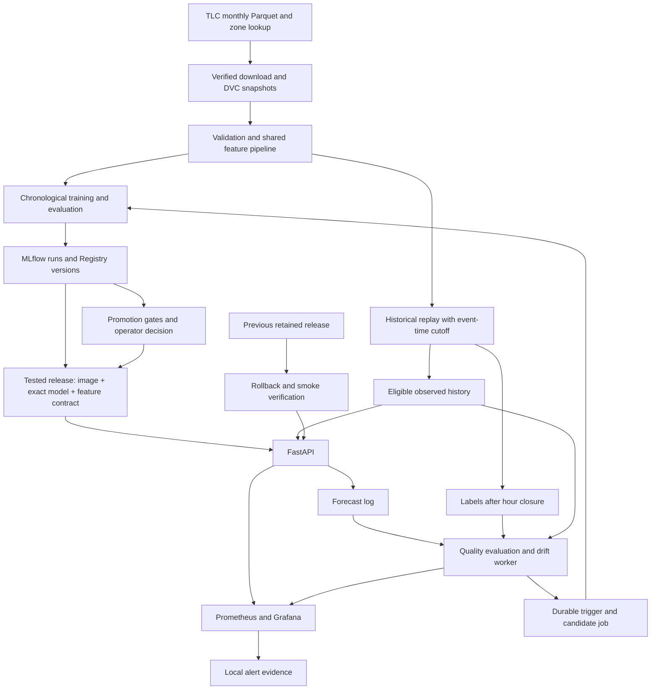

# NYC taxi demand: MLOps project plan

Status: approved by the user; guided implementation begins with milestone 0. Prepared 2026-11-03.

Planning and course review are complete. Approval is recorded. The command-by-command teaching sequence now begins; project implementation will proceed through the milestones with learner verification.

**PHASE 1 — PROPOSE**

Build a reproducible local system that forecasts next-hour yellow-taxi pickups for a fixed set of NYC zones. Follow the course progression: provenance, packaging and CI, serving, four-layer monitoring, drift/retraining, deployment recovery, and incident evidence. Use a simple forecasting model and a small Docker Compose stack.

The deliverable must answer: What is deployed? Which code and data produced it? Is the service healthy? Are its inputs changing? Does it still predict adequately? What happens after an alert? Can the previous release actually be restored?

Team collaboration requirement: maintain the project in a private shared GitHub repository, initially `avakof/nyc-taxi-mlops`, with teammate access and a documented branch/pull-request review workflow. Each teammate recreates a local environment from the committed files. Later DVC and MLflow milestones must provide team-accessible artifact storage; GitHub synchronization alone does not share local data caches or tracking servers.

Review cadence updated at the user's request on 2026-11-04: group multiple lessons and implementation checkpoints on a milestone branch. Commit small changes and push progress regularly. Open a pull request and obtain contributor review when a substantial milestone is complete, rather than after every lesson. The review batches are data foundation, training/tracking, serving, monitoring, and recovery. Continue teaching and local checks between review points; the detailed plan milestones remain implementation checkpoints within those batches.

**PHASE 2 — ADVERSARIAL AUDIT**

The course provides useful teaching patterns, but its exercises are not a complete implementation of this assignment. Specific corrections:

| Risk | Required correction |
|---|---|
| Fraud labs randomly split records | Split every zone on shared chronological boundaries; enforce information availability at forecast time. |
| Monitoring lab trains on records later replayed as live | Use distinct training, calibration, test, and later replay intervals. |
| Some registration, reproduction, API, and monitoring exercises are unfinished | Treat each component as unverified until an explicit acceptance check passes. |
| Some slides use old Registry stages | Use immutable model versions, aliases, and explicit deployment records. |
| An alias may move after a service loads its model | Resolve once, package the exact version, and verify the version actually served after deployment. |
| A DVC pointer may be stale or point to an inaccessible remote | Hash the actual consumed files; demonstrate recovery from an independent checkout. |
| Monthly historical data is mistaken for an hourly live feed | Label the system a historical replay with simulated hourly availability. |
| A histogram change is treated as proof of model failure | Separate data quality, distribution change, prediction change, and observed forecast error. |
| Automatic retraining is confused with automatic deployment | A trigger creates an evaluated candidate; promotion is a separate controlled operation. |
| Rolling back is assumed to fix genuine demand collapse | Use retraining or an evaluated fallback for changed demand; demonstrate rollback with a bad release. |
| A single healthy week is called robust threshold calibration | Allocate two healthy weeks; explicitly retain uncertainty from limited and overlapping windows. |
| Raw trip cleanup changes the meaning of demand | Count valid pickup events; do not remove a pickup solely because fare/distance is unusual. |

The detailed local evidence and reading coverage are in [COURSE_REVIEW.md](COURSE_REVIEW.md).

**PHASE 3 — GROUNDING**

Three verification questions and executed checks:

1. **Does the source support zone-hour aggregation and the proposed historical periods?** The official TLC page lists monthly 2020 yellow-taxi Parquet files and a zone lookup; its dictionary defines pickup timestamps and pickup location IDs. It also states that publication is monthly, typically delayed by two months. This supports historical replay, not a claim of a real-time TLC feed. [TLC source](https://www.nyc.gov/site/tlc/about/tlc-trip-record-data.page), [yellow-taxi dictionary](https://www.nyc.gov/assets/tlc/downloads/pdf/data_dictionary_trip_records_yellow.pdf).
2. **Can tracking, data versioning, and deployment identify recoverable artifacts?** Current MLflow documentation supports database-backed Registry metadata, immutable versions, and aliases; stages are deprecated. DVC describes pipeline dependencies/outputs and restoration of versioned objects. These features support the design only when the objects and runtime are retained. [MLflow Registry](https://mlflow.org/docs/latest/ml/model-registry/workflow/), [backend stores](https://mlflow.org/docs/latest/self-hosting/architecture/backend-store/), [DVC pipelines](https://doc.dvc.org/user-guide/project-structure/dvcyaml-files), [DVC pull](https://doc.dvc.org/command-reference/pull).
3. **Can the proposed forecast convention keep future targets out of features?** A Python check verified disjoint chronological target windows, historical lag timestamps strictly before the forecast origin, and target completion after issuance. The course's random-split patterns were identified by reading the source. This verifies the design convention, not a feature pipeline that has yet to be implemented. [scikit-learn's temporal evaluation example](https://scikit-learn.org/stable/auto_examples/applications/plot_time_series_lagged_features.html).

Confirmed: source format and fields; available month links; complete course inventory; unfinished lab exercises; alias/stage semantics; database-backed Registry requirement; the proposed temporal ordering.

Still unmeasured: taxi file hashes and row counts, actual quality/performance, optimal alert thresholds, training duration, resource requirements, and recovery time. These become recorded outputs during implementation.

**PHASE 4 — SYNTHESIS: APPROVED PLAN**

**1. Project contract and scope**

Predict an expected pickup count for each of 20 supported zones for the next hour. Select the 20 zones by pickup volume in the training interval only, then freeze their IDs in configuration. This keeps the demo small and gives an explicit supported-zone contract. Expansion to every valid NYC zone remains optional.

For an hour boundary T:

- Target: pickups in the interval [T, T + 1 hour).
- Information available: completed pickup-count intervals ending at or before T.
- Features: counts at T−1h, T−2h, T−3h, T−24h, and T−168h; shifted rolling means over 3, 24, and 168 hours; zone identity; local hour, day of week, and weekend indicator.
- Earliest evaluation: after the target hour closes and the observation has arrived.
- Every training row and request records the forecast origin and target interval. All cutoffs use timestamps, never arbitrary row positions across stacked zones.

Example: an issuance at 10:00 forecasts 10:00–11:00. The 09:00–10:00 count may be used under the replay's immediate-hour-close availability assumption. The 10:00–11:00 count may not.

Use America/New_York for local calendar interpretation and UTC for internal interval identity and elapsed-time lags. Treat naïve source timestamps as NYC local wall time under an explicit documented assumption. Quarantine invalid/nonexistent timestamps; define ambiguous-time handling before extending to autumn data. Test the March 2020 daylight-saving transition. A lag of 168 elapsed hours is not always the same local clock hour last week; label that distinction and implement calendar-based baselines deliberately.

The replay advances an explicit event-time clock. It reveals completed observations to the serving history store and labels to the evaluator only when eligible. The full historical table must never be exposed through an unrestricted serving lookup. Report simulation time and wall-clock time separately.

**2. Dataset and evaluation windows**

Download January–April 2020 yellow-taxi data plus the zone lookup. The source files are full monthly files even when only 20 zones are modeled. Process one month or bounded Parquet batches at a time; measure memory during ingestion.

Dates below describe target intervals in New York local time. Boundaries are inclusive at the start and exclusive at the end.

| Role | Interval | Permitted use |
|---|---|---|
| Initial history | Jan 1–Jan 8 | Warm up 168-hour features; not scored training targets |
| Training and drift reference | Jan 8–Feb 3 | Fit the model, preprocessing, zone selection, and reference profiles |
| Healthy validation/calibration | Feb 3–Feb 17 | Compare simple configurations and calibrate provisional monitoring limits |
| Frozen healthy test | Feb 17–Mar 1 | Final initial-release evaluation; not threshold or hyperparameter tuning |
| Later drift/recovery replay | Mar 1–May 1 | Natural drift investigation, causal retraining, and later recovery evaluation |

The training interval contains 26 calendar days; calibration contains 14; the healthy test contains 13. This is sufficient for a course demonstration, not a strong claim of year-round generalization or accurately estimated false-alarm rates.

Reserve a tail of the later replay for post-promotion evaluation. At a retraining decision, use only observations available by that decision's cutoff. Candidate selection uses a later chronological holdout inside already available history; subsequent replay remains unseen until the recovery evaluation.

Create one row per supported zone and real elapsed hour. Distinguish a complete hour with zero pickups from unavailable/invalid input. Record source file and replay completeness. With historical TLC data, completeness means completeness of the accepted source snapshot, not proof that every real-world pickup was reported.

Validate pickup timestamps, supported location IDs, interval membership, schema, finite values, uniqueness of aggregate keys, and count nonnegativity. Reconcile accepted trip counts to aggregated counts. Report rejected rows and reasons. Avoid blind deduplication of trips: without a reliable trip key, two identical-looking rows can represent separate trips. Detect duplicate ingestion by source identity instead.

Fare and distance are retained as source fields where useful for diagnostics, but are excluded from the first forecasting feature set. This avoids depending on information finalized after a trip. Optional-column schema changes should be reported, while required-field failures stop the affected pipeline.

**3. Tools and responsibility boundaries**

| Component | Choice | Responsibility |
|---|---|---|
| Source control | Git | Code, configuration, DVC metadata, tests, documentation |
| Python environment | One supported Python version + uv lockfile | Consistent local, test, training, and image environments; exact pins validated during setup |
| Raw scan and aggregates | PyArrow/DuckDB; pandas for compact feature tables | Bounded-memory Parquet reading and deterministic zone-hour features |
| Forecasting | scikit-learn | Simple model plus transparent baselines |
| Data versions/pipeline | DVC | Raw/processed data identity, dependency graph, cache and restoration |
| Experiment and model metadata | MLflow + explicit SQLite backend | Runs, parameters, metrics, lineage, Registry versions and aliases |
| Model bytes | MLflow artifact storage on a persistent volume | Retained model packages and monitoring references |
| API | FastAPI + Pydantic + Uvicorn | Validated forecasts and operational endpoints |
| Runtime history and audit records | Separate SQLite database | Eligible observations, forecasts, monitoring windows, trigger/deployment state |
| Automation | Python worker/CLI with durable job state | Replay, evaluation, triggering and candidate training |
| Packaging | Docker + Docker Compose | Repeatable local processes, networking, persistent volumes |
| Monitoring | Prometheus, Grafana, Alertmanager | Metrics, dashboards, local alert evidence |
| Verification | pytest, HTTPX/TestClient, container smoke checks; Locust for a small load check | Behavior, integrations, release verification |
| CI | GitHub Actions when repository is connected | Locked install, fast tests, image build/smoke check, retained reports |

Use a single API worker and one serialized training/monitoring worker initially. Serialize replay updates through one writer; allow bounded API forecast-log transactions with WAL/busy-timeout handling and uniqueness constraints. Test contention and restart behavior. SQLite is a local-project choice; no high-availability claim is made.

Core scope does not need Kubernetes, Kubeflow, Kafka, Airflow, a dedicated feature-store service, a GPU, or a paid cloud service. Those can become later learning extensions after all required evidence exists.

MLflow metadata and artifact storage must both persist. DVC storage is separate from MLflow model storage. Runtime observations and prediction logs use a separate database rather than modifying MLflow tables. Docker service names resolve internal connections; localhost refers to the current container.



**4. Data and experiment reproducibility**

The downloader records source URLs, month, download timestamp, size, observed SHA-256, schema, and citation. Initial observed hashes are frozen in a versioned manifest. Later downloads must match the expected snapshot or stop with an explicit change report. A hash identifies bytes; it does not certify source accuracy.

DVC tracks raw files, zone lookup, compact aggregates, feature tables, and deterministic scenario data. Git tracks the `.dvc` metadata, `dvc.yaml`, `dvc.lock`, source manifest, configuration, and code. Raw files, generated model binaries, databases, caches, and runtime logs remain outside Git.

Define deterministic stages for validation, aggregation, feature generation, and evaluation. Separate artifact computation from external side effects such as registration and promotion. A DVC cache hit must not be mistaken for a newly created MLflow run; explicit training/logging operations create and return their run identity. Reproduction comparisons can run without duplicating Registry versions.

Every MLflow training run records:

- Parameters, fixed seed, estimator configuration, feature definition, zone list, and forecast horizon.
- Split boundaries, availability policy, row counts, input schema version, raw-data hashes, processed-data fingerprint, and DVC revision/pointers.
- Git commit and dirty status; release training requires a clean tracked source state.
- Lockfile hash, Python/library versions, runtime platform, and relevant container identity.
- MAE, RMSE, WAPE, baseline comparisons, and per-zone/time-slice diagnostics.
- Model signature and example; estimator plus preprocessing; prediction fixtures; validation report; drift reference; model card.

Verify the hashes of actual consumed bytes, not only metadata files. Reproduction means identical data/configuration and equivalent predictions/metrics within a declared numerical tolerance in the supported environment. Byte-identical model files across arbitrary platforms are not promised. A fresh bootstrap creates new MLflow run/version IDs; equivalent content and provenance must be compared separately from those local IDs.

Use Registry aliases such as `candidate` and `champion` to express selection. Resolve an alias once to an immutable version. Export and validate that exact package before building a release. The runtime loads its bundled artifact once and reports its true version; it does not need the tracking server for each prediction. A registry alias change alone does not redeploy the service.

**5. Modeling and quality policy**

Start with previous-day and previous-week seasonal baselines, with explicit calendar/DST behavior. Train one small histogram gradient-boosting count regressor using a nonnegative count-compatible loss. Fit zone encoding and all learned transformations only on training data. Disable internal random validation/early-stopping splits or provide explicit chronological validation. Keep tuning limited to a few recorded configurations.

Use MAE as the main metric because it expresses typical absolute error in pickups. Also report RMSE for large misses and WAPE = sum(abs(actual − prediction)) / sum(actual). When the denominator is zero, WAPE is unavailable; report MAE and total demand instead. Do not use MAPE as the primary score for sparse/zero-demand hours.

Report overall and per-zone metrics, plus important time-of-day slices. A good overall score can hide a failed zone. Record baseline performance on precisely the same target rows and information availability.

Choose and freeze release tolerances before examining final holdout results. An initial model that does not improve the baseline is documented honestly; serving a tracked baseline is an acceptable operational milestone. Later candidates must beat or meet the declared comparison policy on the same holdout as the champion and baseline, pass important zone guardrails, and pass operational tests. Failed candidates remain retained and undeployed.

**6. Serving contract and integration checks**

Proposed endpoints:

| Endpoint | Purpose |
|---|---|
| `POST /v1/forecast` | Zone ID + forecast origin; retrieve eligible history and return the next-hour expected count |
| `GET /health/live` | Process is responsive |
| `GET /health/ready` | Model/package and required dependencies are usable |
| `GET /model-info` | Exact model version, source run, release ID, code and feature schema |
| `GET /metrics` | Service and latest persisted monitoring metrics |

For forecasts, return target start/end, zone, expected count, forecast/request identifier, model version, and release ID. An expected count may be fractional. Do not accept arbitrary client-supplied lag values as the default public contract; construct features from the controlled history store.

Validate supported zones, timezone-aware hour-aligned origins, available history, staleness, and finite nonnegative outputs. Distinguish invalid requests from unavailable service/history. The README documents exact status codes. Forecast-level history eligibility is checked even if global readiness is healthy.

Persist each forecast once under an idempotent key covering replay/scenario, zone, target/origin, and release. Repeated HTTP calls must not multiply observation rows or bias model-quality metrics. Keep traffic load measurement separate from the unique forecasts used for evaluation.

Integration tests start an isolated MLflow backend, register a small real test model, export its exact version, and run FastAPI through lifespan startup. Also start the actual built container and send HTTP requests. FastAPI documents using `TestClient` as a context manager to exercise lifespan. [FastAPI testing](https://fastapi.tiangolo.com/advanced/testing-events/).

Test valid forecasts, invalid zones/times, insufficient/stale history, missing/corrupt model package, response identity, startup readiness, duplicate requests, and training/serving feature parity. Verify the running API changes version after an actual deployment/rollback.

Provisional local load objective: p95 client latency at or below 200 ms at an achieved 10 requests/second for one minute after warmup, with zero server errors for valid requests. Record hardware, payload, actual throughput, and measurements; this is a proposed test target, not a benchmark already achieved. Adjust it only with an explicit rationale.

**7. Four-layer monitoring**

| Layer | Signals | Operational meaning |
|---|---|---|
| Service | Request count, status/error rate, latency, readiness, worker heartbeat | Can the system execute forecasts? |
| Data | Schema, required values, complete hours, observation freshness, pickup-lag drift | Are inputs available and consistent with expectations? |
| Predictions | Forecast distribution, total demand forecast, zero share, selected-zone slices | Has model behavior changed? |
| Outcomes | MAE/RMSE/WAPE, baseline-relative error, label coverage and freshness | Is predictive performance acceptable on observed targets? |

Use stable route/status labels in Prometheus. Keep per-request identifiers in logs and individual forecast records. Metric labels must not grow with every request. The official instrumentation guide supports monitoring requests/errors/latency and cautions against unbounded label cardinality. [Prometheus instrumentation](https://prometheus.io/docs/practices/instrumentation/).

Compute data drift over unique zone-hour observations in event time, independently of API traffic. Start with PSI on selected lag-count distributions over complete seven-day windows, evaluated daily, plus a faster demand-volume deviation signal against the frozen seasonal reference. Calibrate thresholds on healthy validation, record sample sizes, and require persistence. Two weeks provide limited calibration evidence; do not claim a precise false-positive rate.

Handle repeated quantiles/zero-heavy counts, actual reference bin shares, smoothing, and out-of-range values explicitly. Use calendar-aware/seasonality-adjusted comparisons. Store reference data, bins, thresholds, feature schema, and reference hash with the corresponding release. An insufficient or stale window is marked unavailable, never silently healthy.

Evaluate outcome metrics only on closed, available target hours. Use left joins/coverage accounting so missing labels cannot disappear from reports. Segment results by model/release, scenario, and window; do not mix old/new release performance in a single unlabeled figure.

Prometheus uses wall-clock scrape time. The evaluator uses simulation/event time. Persist every decision/report with both clocks; expose the current replay position on dashboards. During an accelerated demo, pause at checkpoints long enough for scrape/alert evaluation, or use persisted alert events as the authoritative record. Do not silently reinterpret Prometheus `for` durations as simulated hours.

**8. Trigger, retraining, and promotion**

The trigger is a running worker capability, not a TODO or a printed recommendation.

Decision flow:

1. Persist the completed monitoring window and evidence.
2. For required-schema or ingestion failures, quarantine the affected input and prevent training on it.
3. For sustained drift or labeled performance degradation, create a durable retraining request.
4. Check cooldown, minimum valid/available history, label coverage, and whether a job already exists for the incident.
5. If history is insufficient, retain a deferred request and revisit it after more eligible data arrives.
6. Initial policy: use 21 complete target days for training followed by seven complete target days for validation, with another 168 hours of preceding feature context. Require 100% expected zone-hour coverage and at least 14 complete labeled days since the incident onset, so at least seven changed-regime days can precede the seven-day holdout. All targets must be available by the decision cutoff. Otherwise defer.
7. Freeze and hash the evaluation snapshot. Compare candidate, champion, and baseline on identical held-out zone-hours, feature values, and outcome versions.
8. Record all results in MLflow. Pass or fail the declared gates.
9. A passing candidate becomes eligible for explicit promotion; a failing candidate remains undeployed.
10. Validate the promoted release on subsequent replay that has not been used for fitting or candidate selection.

Persist incident ID, triggering window and hash, model version, reason, state, attempt count, candidate run/version, and decision. Use a uniqueness constraint and a single active worker so repeated alerts/restarts do not create duplicate jobs. Initial policy: seven event-time days between new candidate attempts for the same open incident, at most two automatic attempts, and bounded transient execution retries attached to the original job. A continuing incident updates one open case. Close it after seven complete healthy daily evaluations; a later breach can open a new case. All values are configurable and frozen before the final incident run.

Initial candidate gates: at least 5% lower aggregate MAE than the champion, MAE no worse than the best declared baseline, no supported zone with more than 10% MAE regression, non-increasing WAPE where defined, 100% holdout label coverage, and passing compatibility/readiness/smoke checks. When the champion's MAE is zero, require zero candidate MAE and a separately recorded operational reason to replace it. These are project policy choices, not empirically established business thresholds; review and freeze them during the healthy calibration milestone before candidate outcomes are inspected. Insufficient evidence means defer/reject, not automatic approval.

Possible job states: requested, deferred, running, failed, evaluated, rejected, approved, deployed. Reconcile interrupted work after restart; registration/export must not silently create duplicate versions on retry.

Promotion validates quality gates, feature/runtime compatibility, provenance, readiness, and a smoke forecast. A release manifest binds exact model version, model/reference hashes, feature contract, configuration, code commit, and immutable image identity. Locally use the built image content ID; if published, record the registry digest. Record both intended and actually served identities.

**9. Rollback design**

Retain at least two tested release packages and images. The previous release includes its compatible preprocessing, feature schema, reference profile, configuration, and model artifact.

The rollback procedure selects the previous release manifest, starts/restarts the service with its exact artifact, waits for readiness, verifies `/model-info`, performs a known forecast, checks error/latency behavior, and records the result. Update the Registry alias to reflect deployment only after the actual running release is verified; record and reconcile any partial failure.

Do not rewind the observation database when rolling back a model. The older release must accept the current history schema or be declared incompatible. Keep migrations backward compatible for the project; an incompatible migration blocks a simple rollback.

A single local service restart may cause brief downtime. Zero-downtime deployment is optional. Provisional recovery target: restore a prebuilt known-good release within two wall-clock minutes; measure and report the actual result.

The rollback drill uses a deliberately faulty release in the isolated demo. The natural demand-collapse incident uses candidate retraining or an evaluated fallback as the potential corrective action. An older model trained on the same obsolete demand regime is not assumed to improve forecasting.

**10. Incident scenario and evidence**

Maintain two reproducible paths:

- **Historical analysis:** replay March–April 2020 against the pre-March reference, observe the actual changes, and report measured behavior. Do not promise a particular alert or quality loss before measurement.
- **Deterministic presentation scenario:** create a separate DVC-tracked copy of the Feb 17–Apr 30 evaluation/replay stream. Preserve the preceding January–February history for lag and training context. Replay Feb 17–29 unchanged as the healthy demonstration, then apply a seeded pickup-count thinning rule from March 1, such as retaining approximately 20% of demand. The earliest candidate decision is March 15 after 14 complete post-injection days; reserve April 15–30 as a final recovery evaluation tail, with no further fitting or promotion selection on that tail. Keep the original dataset unchanged. Derive later features and labels causally from the transformed count stream. Do not multiply only API inputs while evaluating against unrelated original labels. Run an unmodified paired control: natural March–April changes remain in the source, so attribute the extra injected effect using the control rather than claiming every observed change was caused by the injection.

Select scenario settings on a development rehearsal; freeze them for a final replay. Final healthy test scores always use the unmodified healthy data. Keep natural drift, healthy controls, synthetic collapse, and bad-release drills isolated by scenario ID, DVC artifacts, runtime database or namespace, forecast records, monitoring windows, and trigger state. Keep incident rehearsal and final confirmation runs labeled separately.

The recorded incident shows a healthy baseline, injection point, detection evidence, diagnosis, trigger state, candidate result, chosen response, and subsequent recovery measurement. A rejected candidate is a valid outcome if the decision is explained and the safe serving/fallback state is documented. Add a separate bad-release rollback drill to prove restoration.

The postmortem contains impact, affected zones/hours, detection and response timeline, data/code/model/release identities, root cause versus symptoms, decision rationale, before/after metrics, detection and recovery durations in both clocks, what worked, gaps, and corrective actions with acceptance checks. The system's quality after recovery must be measured rather than assumed.

**11. Milestones and teaching progression**

Each milestone produces reviewable evidence. Dependencies follow the table order; small documentation/test improvements continue throughout.

| Milestone | Work and deliverables | Why it exists | Completion evidence |
|---|---|---|---|
| 0. Contract | Task definition, time windows, forecast availability, supported zones, metrics, incident specification | Prevent ambiguity and leakage before implementation | A concrete timestamp example and agreed acceptance criteria |
| 1. Repository/environment | Project skeleton, locked environment, configuration, `.env.example`, ignore rules, initial CI | Make every later command repeatable | Clean setup on supported environment; no secrets/raw data tracked |
| 2. Acquisition/versioning | Downloader, source manifest, schema report, DVC raw snapshots and restore path | Identify exactly which observations exist | Hash validation and restoration after removing a working copy |
| 3. Aggregation/features | Zone-hour counts, frozen zone list, causal lags/rolling features, shared transformation code | Define the actual forecasting dataset | Count reconciliation, unique keys, time/DST and no-future-information checks |
| 4. Tracking/model | Baselines, simple regressor, chronological reports, MLflow provenance, Registry candidate, reproduction check | Make a model explainable and reconstructible | Trace one model to code/data/environment; reproduce predictions within tolerance |
| 5. API | Forecast/history contract, loaded model identity, readiness, logs, integration tests | Turn the artifact into a usable service | A real-model request succeeds; invalid/unavailable cases behave correctly; release v0.1 |
| 6. Packaging/CI | Docker image, Compose services/volumes, build and HTTP smoke workflow | Catch environment and integration failures before release | A tested container starts from a clean environment; release v0.2 |
| 7. Replay/monitoring | Causal replay, persisted forecasts/labels, dashboards, four monitoring layers | Observe service and model behavior over time | Healthy replay with honest unavailable/coverage states and reconciled forecasts |
| 8. Drift/alerts | Reference artifacts, windowed drift, demand signal, local alerts, scenario injection | Detect meaningful change without relying on HTTP traffic volume | Healthy control and frozen drift scenario produce documented outcomes; release v0.3 |
| 9. Retraining | Durable requests, cooldown/retries, candidate training/evaluation and rejection gates | Convert a signal into a controlled operational response | Repeated trigger does not duplicate work; a failing candidate stays undeployed |
| 10. Promotion/recovery | Release manifests, gated promotion, retained previous image, rollback runbook | Make deployment changes reversible and observable | Actual served version changes and is restored; restart/partial-failure checks; release v0.4 |
| 11. Final evidence | Incident postmortem, model/data cards, README, independent fresh-clone rehearsal, demo backup | Make the project assessable by another person | Another clean checkout starts the system and replays the documented incident; release v1.0 |

Time budget is not fixed because the deadline and current familiarity are unspecified. Track completion by these gates. If time becomes constrained, retain every required operational capability and reduce model tuning, zone count, UI polish, and optional infrastructure first.

**12. Planned repository layout**

```text
README.md
pyproject.toml / uv.lock / .python-version
.env.example / .gitignore / .dockerignore
params.yaml / dvc.yaml / dvc.lock
config/                 # periods, zones, schema, monitoring and release policy
src/taxi_mlops/
  data/                 # download, validate, aggregate
  features/             # one shared causal feature implementation
  training/             # baselines, fit, evaluate, reproduce
  registry/             # logging, registration, exact-version export
  api/                  # schemas, lifespan, endpoints, metrics
  monitoring/           # drift, label joins, coverage, alert events
  operations/           # replay, trigger, worker, promote, rollback
tests/                  # meaningful unit, data, integration, recovery tests
tests/fixtures/         # small synthetic data; safe to commit
infra/                  # Dockerfile, Compose, Prometheus/Grafana/Alertmanager
.github/workflows/      # fast CI and separate training/release jobs
data/                   # DVC-managed data; raw bytes excluded from Git
reports/                # generated evaluations and incident evidence
docs/                   # architecture, data/model cards, runbooks, postmortem
releases/               # small provenance manifests, not model binaries
course/                 # reference material; do not automatically add it to Git
```

This is a proposed layout, not created application code. Keep the existing course assets separate from the project submission so its sample datasets/models are not accidentally committed as project artifacts.

**13. CI, secrets, and fresh-clone requirements**

Fast PR checks use small synthetic data: lint, deterministic feature/data tests, temporal invariants, real-model API integration through an isolated Registry, image build, and HTTP container smoke test. Persist reports. Full TLC download, full retraining, and incident replay run separately on demand or on a deliberate schedule.

Pin third-party actions to full commit SHAs and use minimum workflow permissions. GitHub documents SHA pinning as the immutable action reference. [GitHub secure-use reference](https://docs.github.com/en/actions/reference/security/secure-use).

Local secrets live in `.env`, excluded from Git and image build context. Commit `.env.example` with placeholders. CI receives secrets through its secret store, never a committed `.env`. Avoid secrets in MLflow parameters, logs, manifests, or image layers. Bind local management interfaces to loopback and persist relevant state in named volumes. Public deployment is an optional separate scope.

The README must support two concrete recovery cases:

1. **Bootstrap:** fresh clone, documented prerequisites/environment, verified TLC downloads, DVC feature pipeline, reproducible training and registration, service startup, forecast and demo. This path cannot depend on the author's old MLflow database or home-directory cache.
2. **Exact artifact restore:** checkout a release and restore retained DVC objects/model/release artifacts from a documented location available to the evaluator. Demonstrate access independently. A local DVC remote is acceptable during development but does not count as cross-machine delivery. Select a shared remote or external downloadable archive/bundle during implementation; retain original source snapshots in case TLC replaces a public file.

The README states expected disk/download needs after measurement, service ports, startup order, health checks, commands, example responses, stop/restart behavior, safe cleanup, and troubleshooting. Clearly distinguish preserving volumes from destructive reset.

Before submission, rehearse with empty local caches and no original tracking server. A checksum mismatch must not be silently accepted. Record the Git revision and artifacts used for the rehearsal.

**14. Presentation fallback**

Prepare data and images before presenting. Preserve a short terminal/screen recording, dashboard captures, saved drift/evaluation reports, MLflow run/version details, a prebuilt known-good image, and a completed incident report. Use a small deterministic replay slice for the live demonstration; avoid downloading full months or training the full model during the presentation.

The presentation sequence is: prediction and loaded identity → lineage → healthy monitoring → injected drift → alert/trigger → candidate decision → verified recovery → separate rollback proof. If a live service fails, use the saved evidence and state that it is a recorded run.

**15. Definition of done**

- All seven requested capabilities have executable evidence: tracking, DVC/Registry versioning, FastAPI/integration tests, drift monitoring, retraining trigger, rollback, and simulated incident report.
- Every release can be traced to code, actual data bytes, feature definition, environment, run, model, and image.
- Splits and replay respect time; transformations, zone selection, and references do not learn from future/test data.
- Unknown or stale data is visible; drift scores are not represented as proven quality degradation.
- A duplicate alert does not duplicate training; a failed candidate does not reach the service.
- A rollback restores the actual served artifact and compatible reference/runtime, with measured recovery evidence.
- Raw taxi data and secrets are absent from Git; TLC attribution is present.
- A clean clone reproduces a working system and documented demo without hidden machine state.
- The presentation has an offline evidence fallback.

**Teaching format after approval**

Deliver one manageable step at a time. Each step contains the objective, concept and reason, exact actions/commands or code, expected output, a verification check, common failure modes and diagnosis, and a short comprehension exercise. Review the result before dependent work. Explain commands and tool boundaries as they appear; do not deliver the entire implementation as an unexplained code dump.

Approval has been received for this plan. The guided implementation sequence starts with milestone 0; no application implementation was performed during planning.

**Confidence: 90/100 — subjective confidence in plan coverage and feasibility, not a measured probability of system success.**

**Delta from the initial proposal:** explicit historical replay and label availability; longer healthy calibration; corrected course scaffolding assumptions; actual-byte provenance; immutable deployment identity; controlled candidate promotion; complete release rollback; independent fresh-clone evidence; DST, unknown-data, and accelerated-clock handling.
